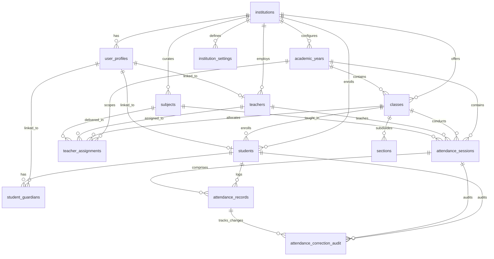

# AttendX Relational Database Schema Documentation
**PostgreSQL 15+ (Supabase) • Flyway Versioned Migrations**

---

## 1. Schema Entity-Relationship Model

---

## 2. Table Specifications & Constraints

### 2.1 `institutions`
- `id` (VARCHAR(36), PK): UUID
- `code` (VARCHAR(50), UNIQUE, NOT NULL): Institutional code (e.g. `SSE-SIMATS`)
- `name` (VARCHAR(255), NOT NULL): University or College name
- `type` (VARCHAR(50)): `COLLEGE` or `UNIVERSITY`
- `is_active` (BOOLEAN): Status toggle

### 2.2 `user_profiles`
- `id` (VARCHAR(36), PK): UUID
- `supabase_user_id` (VARCHAR(100), UNIQUE): Maps to `auth.users(id)` in Supabase Auth
- `email` (VARCHAR(150), UNIQUE, NOT NULL)
- `full_name` (VARCHAR(150), NOT NULL)
- `role` (VARCHAR(30), NOT NULL): `CHECK (role IN ('ADMIN', 'TEACHER', 'STUDENT', 'PARENT'))`
- `status` (VARCHAR(30), NOT NULL): `CHECK (status IN ('ACTIVE', 'INACTIVE', 'SUSPENDED'))`

### 2.3 `academic_years`
- `id` (VARCHAR(36), PK)
- `code` (VARCHAR(50), NOT NULL): e.g. `2025-2026`
- `start_date` (DATE, NOT NULL), `end_date` (DATE, NOT NULL)
- `is_current` (BOOLEAN)
- `status` (VARCHAR(30)): `CHECK (status IN ('ACTIVE', 'ARCHIVED'))`
- **Constraint**: `UNIQUE (institution_id, code)`

### 2.4 `classes`
- `id` (VARCHAR(36), PK): e.g. `BE-CSE-3A`
- `academic_year_id` (VARCHAR(36), FK -> `academic_years(id)`)
- `name` (VARCHAR(150), NOT NULL)
- `department` (VARCHAR(100), NOT NULL)
- `year_of_study` (INT, NOT NULL), `semester` (INT, NOT NULL)
- **Constraint**: `UNIQUE (institution_id, code)`

### 2.5 `sections`
- `id` (VARCHAR(36), PK)
- `class_id` (VARCHAR(36), FK -> `classes(id)`)
- `name` (VARCHAR(50), NOT NULL): e.g. `A`, `B`
- `capacity` (INT, DEFAULT 60)
- **Constraint**: `UNIQUE (class_id, name)`

### 2.6 `subjects`
- `id` (VARCHAR(36), PK)
- `code` (VARCHAR(50), NOT NULL): e.g. `CS301`
- `name` (VARCHAR(200), NOT NULL)
- `department` (VARCHAR(100), NOT NULL)
- `credits` (INT, DEFAULT 4)
- **Constraint**: `UNIQUE (institution_id, code)`

### 2.7 `teachers`
- `id` (VARCHAR(36), PK)
- `employee_id` (VARCHAR(50), NOT NULL): e.g. `FAC-CSE-001`
- `user_profile_id` (VARCHAR(36), FK -> `user_profiles(id)`)
- `full_name` (VARCHAR(150), NOT NULL), `email` (VARCHAR(150), UNIQUE, NOT NULL)
- `department` (VARCHAR(100), NOT NULL), `designation` (VARCHAR(100), NOT NULL)
- **Constraint**: `UNIQUE (institution_id, employee_id)`

### 2.8 `students`
- `id` (VARCHAR(36), PK)
- `registration_number` (VARCHAR(50), NOT NULL): e.g. `192211001`
- `class_id` (VARCHAR(36), FK -> `classes(id)`), `section` (VARCHAR(10), NOT NULL)
- `academic_year_id` (VARCHAR(36), FK -> `academic_years(id)`)
- `full_name` (VARCHAR(200), NOT NULL), `email` (VARCHAR(150), UNIQUE, NOT NULL)
- `status` (VARCHAR(30)): `CHECK (status IN ('ACTIVE', 'INACTIVE', 'DEBARRED'))`
- **Constraint**: `UNIQUE (institution_id, registration_number)`

### 2.9 `teacher_assignments`
- `id` (VARCHAR(36), PK)
- `teacher_id` (VARCHAR(36), FK -> `teachers(id)`)
- `class_id` (VARCHAR(36), FK -> `classes(id)`), `section` (VARCHAR(10))
- `subject_id` (VARCHAR(36), FK -> `subjects(id)`)
- **Constraint**: `UNIQUE (teacher_id, class_id, section, subject_id, academic_year_id)`

### 2.10 `attendance_sessions`
- `id` (VARCHAR(36), PK)
- `class_id` (VARCHAR(36), FK), `section` (VARCHAR(10)), `subject_id` (VARCHAR(36), FK), `teacher_id` (VARCHAR(36), FK)
- `session_date` (DATE, NOT NULL), `period` (VARCHAR(50), NOT NULL)
- `present_count` (INT), `absent_count` (INT), `attendance_percentage` (DECIMAL(5,2))
- `is_locked` (BOOLEAN, DEFAULT FALSE)
- `submission_status` (VARCHAR(30)): `CHECK (submission_status IN ('DRAFT', 'SUBMITTED', 'FINALIZED'))`
- **Constraint**: `UNIQUE (class_id, section, subject_id, session_date, period)` — Prevents duplicate sessions!

### 2.11 `attendance_records`
- `id` (VARCHAR(36), PK)
- `session_id` (VARCHAR(36), FK -> `attendance_sessions(id)`)
- `student_id` (VARCHAR(36), FK -> `students(id)`)
- `registration_number` (VARCHAR(50), NOT NULL)
- `status` (VARCHAR(20), NOT NULL): `CHECK (status IN ('PRESENT', 'ABSENT', 'OD', 'LATE'))`
- **Constraint**: `UNIQUE (session_id, student_id)` — Prevents multiple records for same student in a session!

### 2.12 `attendance_correction_audit`
- `id` (VARCHAR(36), PK)
- `record_id` (VARCHAR(36), FK -> `attendance_records(id)`)
- `session_id` (VARCHAR(36), FK), `student_id` (VARCHAR(36), FK)
- `original_status` (VARCHAR(20), NOT NULL), `corrected_status` (VARCHAR(20), NOT NULL)
- `correction_reason` (TEXT, NOT NULL)
- `changed_by_user_id` (VARCHAR(36)), `changed_by_name` (VARCHAR(150))
- `changed_at` (TIMESTAMP WITH TIME ZONE DEFAULT CURRENT_TIMESTAMP)

