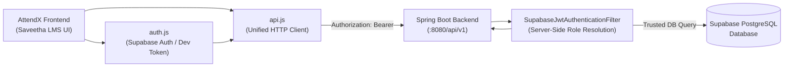

# AttendX — Milestone 6: Frontend-Backend API Integration Guide

This document details the communication architecture between the **AttendX (MaccaAttendX)** frontend application and the **Spring Boot 3.3.5 REST backend**.

---

## 1. Overview & Architecture

AttendX employs a clean, decoupled client-server architecture:
- **Frontend**: Vanilla ES6+ modular SPA adhering to the Saveetha V-Study LMS design system.
- **Backend**: Java 21 + Spring Boot 3.3.5 + Spring Data JPA + Spring Security.
- **Database**: Supabase PostgreSQL (dev runs on H2 with PostgreSQL syntax dialect for rapid offline verification).
- **Authentication**: Supabase Auth (JWT Bearer tokens), verified server-side with zero trust on client-supplied roles.



---

## 2. Centralized API Client (`frontend/js/api.js`)

All outbound network requests flow through `frontend/js/api.js`. Key capabilities:
1. **Dynamic Base URL Resolution**: Automatically detects whether running alongside backend on `http://localhost:8080/api/v1`, on Vite dev server, or custom `window.VITE_API_BASE_URL`.
2. **Automatic Bearer Token Injection**: Retrieves `attendx_token` from `sessionStorage` and attaches `Authorization: Bearer <token>` on every request.
3. **12-Second Timeout with AbortController**: Prevents hanging requests if network connectivity degrades.
4. **Binary Blob Downloading**: Supports streaming native Apache POI `.xlsx` files directly to the browser file system.
5. **Session Expiry Handling**: Detects `401 Unauthorized` responses, clears invalid credentials, and triggers the login modal via `Auth.handleUnauthorized()`.

### Endpoint Namespaces in `Api`:
- `Api.auth`: `/auth/me`, `/auth/mock-token`
- `Api.dashboard`: `/dashboard/{role}` (`ADMIN`, `TEACHER`, `STUDENT`, `PARENT`)
- `Api.students`: `/students`, `/students/{id}`, `/students/{id}/deactivate`
- `Api.teachers`: `/teachers`, `/teachers/{id}`
- `Api.academics`: `/academics/classes`, `/academics/subjects`, `/academics/years`
- `Api.attendance`: `/attendance/roster`, `/attendance/sessions`, `/attendance/records/{id}/correct`, `/attendance/my-attendance`, `/attendance/parent/children`
- `Api.reports`: `/reports/overall`, `/reports/low-attendance`, `/reports/class/{id}`, `/reports/export/excel`
- `Api.settings`: `/settings/institution`, `/settings/thresholds`

---

## 3. Endpoints Matrix

| Frontend Module | Target REST Endpoint | HTTP Method | Server-Side RBAC | Purpose |
| :--- | :--- | :---: | :---: | :--- |
| **Authentication** | `/api/v1/auth/me` | `GET` | Authenticated | Resolves caller identity, trusted DB role, and profile info |
| | `/api/v1/auth/mock-token` | `POST` | Public (Dev) | Issues deterministic development bearer tokens |
| **Admin Dashboard** | `/api/v1/dashboard/admin` | `GET` | `hasRole('ADMIN')` | Live system stats, student count, faculty count, today's attendance |
| **Teacher Dashboard**| `/api/v1/dashboard/teacher`| `GET` | `hasRole('TEACHER')`| Live faculty workload, assigned subjects, pending attendance |
| **Student Dashboard**| `/api/v1/dashboard/student`| `GET` | `hasRole('STUDENT')`| Caller's overall %, attended vs conducted, course breakdown |
| **Parent Dashboard** | `/api/v1/dashboard/parent` | `GET` | `hasRole('PARENT')` | Linked wards summary, attendance alerts, live stats |
| **Student Directory**| `/api/v1/students` | `GET` | `hasAnyRole('ADMIN', 'TEACHER')` | Paginated and filtered student list |
| | `/api/v1/students` | `POST` | `hasRole('ADMIN')` | Register new student record |
| | `/api/v1/students/{id}` | `PUT` | `hasRole('ADMIN')` | Update student profile and contact details |
| | `/api/v1/students/{id}` | `DELETE` | `hasRole('ADMIN')` | Deactivate student account while preserving audit trail |
| **Academic Hierarchy**| `/api/v1/academics/classes` | `GET` | Authenticated | List all active degree programs and sections |
| | `/api/v1/academics/subjects` | `GET` | Authenticated | List curriculum course offerings |
| | `/api/v1/academics/years` | `GET` | Authenticated | Active academic calendar years |
| **Teacher Management**| `/api/v1/teachers` | `GET` | Authenticated | Faculty directory with department allocations |
| **Attendance Roster**| `/api/v1/attendance/roster` | `GET` | `hasAnyRole('ADMIN', 'TEACHER')` | Active enrolled students for specific class and section |
| **Submit Attendance**| `/api/v1/attendance/sessions` | `POST` | `hasAnyRole('ADMIN', 'TEACHER')` | Submit and lock session; calculates % and prevents duplicates |
| **Audited Correction**| `/api/v1/attendance/records/{id}/correct` | `POST` | `hasRole('ADMIN')` | Modify status with mandatory reason and immutable audit log |
| **Correction History**| `/api/v1/attendance/records/{id}/corrections` | `GET` | `hasAnyRole('ADMIN', 'TEACHER')` | Retrieve correction audit log |
| **Student My Attendance** | `/api/v1/attendance/my-attendance` | `GET` | `hasRole('STUDENT')` | Resolves student's own attendance via token (IDOR safe) |
| **Parent Ward Access**| `/api/v1/attendance/parent/children` | `GET` | `hasRole('PARENT')` | Returns linked wards' attendance records (IDOR safe) |
| **Reports Overall** | `/api/v1/reports/overall` | `GET` | `hasAnyRole('ADMIN', 'TEACHER')` | Aggregated institutional attendance percentage |
| **Low Attendance** | `/api/v1/reports/low-attendance` | `GET` | `hasAnyRole('ADMIN', 'TEACHER')` | Filter students falling below configurable threshold |
| **Native Excel Export**| `/api/v1/reports/export/excel` | `GET` | `hasAnyRole('ADMIN', 'TEACHER')` | Generates and streams Apache POI binary `.xlsx` |

---

## 4. Error Handling and Resilience

1. **Standard Envelope**: All JSON API responses adhere to the `ApiResponse<T>` contract:
   ```json
   {
     "success": true,
     "message": "Operation completed successfully",
     "data": { ... },
     "timestamp": "2026-11-05T14:10:30.211Z",
     "pagination": { "currentPage": 0, "totalPages": 1, "totalElements": 25, "pageSize": 20 }
   }
   ```
2. **Network Failures**: When the Spring Boot server is offline or unreachable, `Api.request()` surfaces clean, human-readable banner notifications (`"Unable to connect to AttendX server. Please check that the Spring Boot backend is running on port 8080."`) and safely falls back to local cache so the user can continue viewing previously loaded screens.
3. **HTTP 409 Conflict**: Returned when submitting duplicate attendance for the same class/date/period, or attempting to register a duplicate registration number.
4. **HTTP 403 Forbidden**: Returned if a Teacher attempts administrative actions (e.g. creating/deleting students, editing locked attendance).
5. **HTTP 401 Unauthorized**: Handled automatically by clearing the expired session token and presenting the Supabase authentication dialog.

