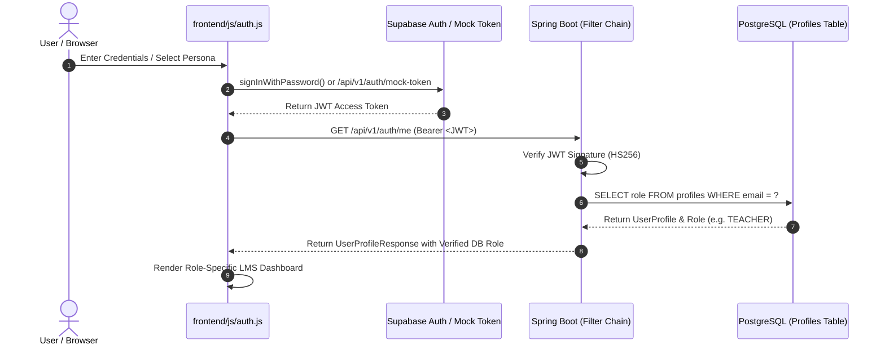

# AttendX — Supabase Authentication & Role Resolution Architecture

This guide describes the end-to-end authentication and identity lifecycle in **AttendX (MaccaAttendX)**.

---

## 1. Zero-Trust Security Principle

In AttendX, **client-provided roles are never trusted for authorization**.
- A malicious user modifying local storage, JavaScript variables, or crafting manual HTTP requests cannot elevate their permissions.
- Authorization decisions are strictly evaluated inside Spring Security by looking up the authenticated user's email in the PostgreSQL `profiles` table.



---

## 2. Authentication Modes

AttendX natively supports two authentication modes:

### Mode A: Production Mode (Supabase Auth)
- Powered by `@supabase/supabase-js` v2.
- The user enters their institutional email and password into the Saveetha-themed modal dialog.
- The Supabase client sends credentials to the institutional Supabase Auth project (`https://<project-ref>.supabase.co`).
- Upon successful login, Supabase returns a cryptographically signed JWT containing claims (`sub`, `email`, `role = "authenticated"`, `exp`).
- Frontend passes this JWT in the `Authorization: Bearer <token>` header.
- Spring Security verifies the signature using the configured `supabase.jwt.secret`.

### Mode B: Development Mode (Persona Switcher)
- Facilitates rapid institutional testing and evaluation across all 4 user personas (`Admin`, `Teacher`, `Student`, `Parent`) without requiring live internet connectivity or email OTP confirmation.
- Selecting a persona triggers `Auth.loginWithPersona(role)`.
- The frontend calls `POST /api/v1/auth/mock-token` with `{ "role": "TEACHER" }`.
- The Spring Boot backend issues a deterministic development token.
- `SupabaseJwtAuthenticationFilter` resolves the corresponding seed profile:
  - `Admin`: `admin@saveetha.com` -> Role `ADMIN`
  - `Teacher`: `priya.r@saveetha.com` -> Role `TEACHER` (`FAC-CSE-001`)
  - `Student`: `arun.k@saveetha.com` -> Role `STUDENT` (`192211001`)
  - `Parent`: `karthik.parent@gmail.com` -> Role `PARENT` (linked to `192211001`)

---

## 3. IDOR Prevention (Insecure Direct Object Reference)

To protect student and parent privacy:
1. **Student "My Attendance"**:
   - The student accesses `/api/v1/attendance/my-attendance`.
   - The endpoint **does not accept** a `studentId` query parameter.
   - Spring Security extracts the authenticated caller's email from the JWT (`SecurityUtils.getCurrentUserEmail()`).
   - The service fetches the student record matching that email. A student can never inspect another student's record.
2. **Parent Ward Access**:
   - The parent accesses `/api/v1/attendance/parent/children`.
   - Spring Security extracts the authenticated parent's email.
   - The service queries the `guardians` table to find only the students officially linked to that parent's profile.

---

## 4. Frontend Integration API (`frontend/js/auth.js`)

Key methods provided:
```javascript
// Initialize Supabase client and restore existing session
await Auth.init();

// Login via Supabase Auth credentials
const result = await Auth.loginWithSupabase('admin@saveetha.com', 'password123');

// Switch persona (Dev mode)
const ok = await Auth.loginWithPersona('TEACHER');

// Check role
if (Auth.hasRole('ADMIN')) {
    // Show admin-only controls
}

// Logout & invalidate session
Auth.logout();
```

